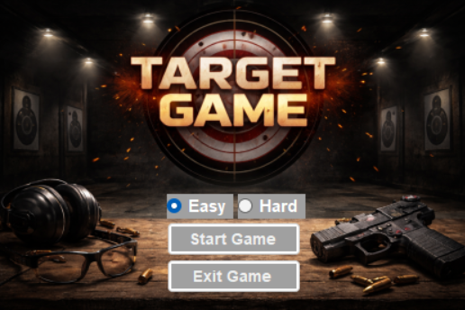
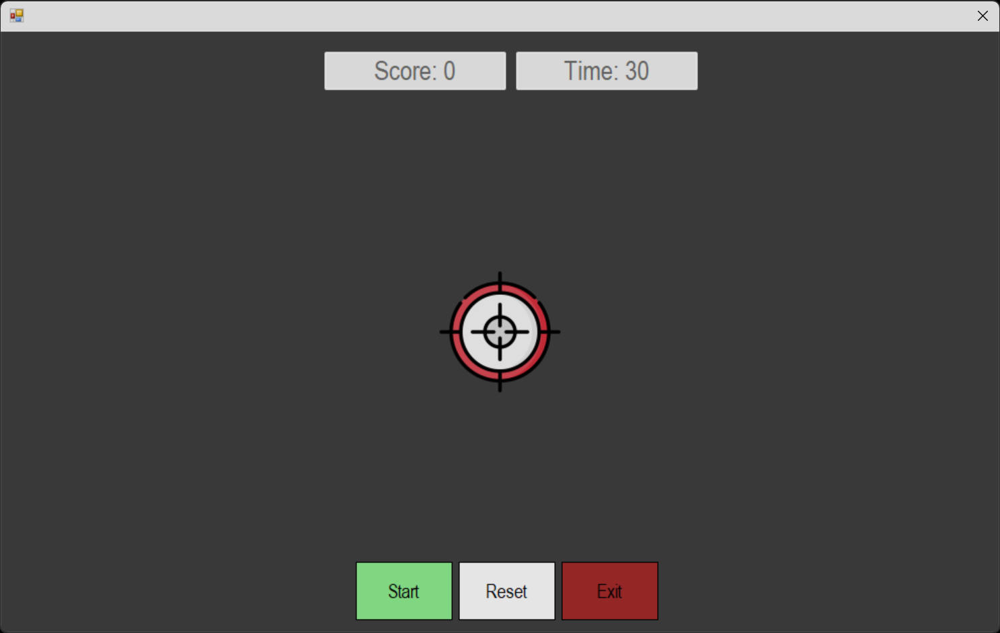

# TARGET_GAME

**TARGET_GAME** is a fast-paced Windows desktop aim-trainer and target-shooting game built with C# and Windows Forms. Test your reflexes and accuracy by clicking as many targets as possible before the 30-second timer runs out!

## Screenshots

### Main Menu


### Gameplay


## Features

* **Difficulty Modes:** Choose between **Easy** and **Hard** modes from the main menu to match your skill level.
* **Timed Arcade Action:** Race against a **30-second countdown timer** to rack up the highest score possible.
* **Intuitive Controls:** Point and click directly on the moving crosshair targets using your mouse, with quick-access **Start**, **Reset**, and **Exit** buttons on the game board.
* **Themed Interface:** Features a custom shooting-range main menu and a clean, distraction-free dark arena for gameplay.

## Prerequisites

Before running the project, ensure you have the following installed:

* [.NET Framework / .NET SDK](https://dotnet.microsoft.com/) (Update with your specific target version, e.g., .NET Framework 4.7.2 or .NET 8.0)
* [Visual Studio](https://visualstudio.microsoft.com/) (2019 or later recommended)

## Getting Started

1. **Clone the repository:**

   ```bash
   git clone https://github.com/your-username/TARGET_GAME.git
   ```

2. **Open the project:**
   Navigate to the project folder and open the `.sln` (Solution) file in Visual Studio.

3. **Configure App Settings:**
   If your project requires specific configurations, rename or create an `App.config` file in the root directory (note that `App.config` is currently ignored in `.gitignore`).

4. **Build and Run:**
   Press `F5` or click **Start** in Visual Studio to compile and launch `TARGET_GAME.exe`.

## Project Structure

```text
TARGET_GAME/
├── bin/               # Compiled binaries (ignored by Git)
├── Properties/        # Assembly and project settings
├── Resources/         # Embedded game assets, images, and audio
├── screenshots/       # Images used in the README documentation
├── Program.cs         # Main application entry point
└── README.md          # Project documentation
```

## Contributing

Contributions, issues, and feature requests are welcome! Feel free to check the issues page or submit a pull request.

## License

This project is licensed under the [MIT License](LICENSE) - see the `LICENSE` file for details.
